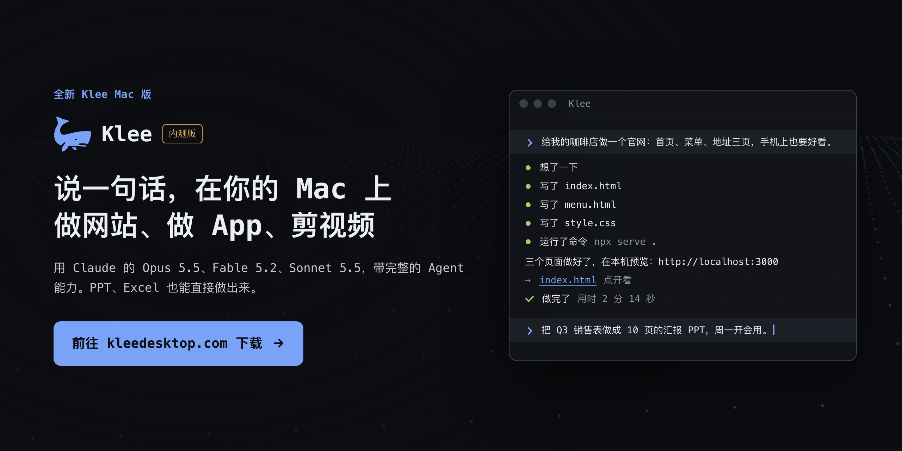

# Klee

[English](README.md) · **简体中文**

<a href="https://kleedesktop.com"></a>

> **想用云端更强的模型和完整的 Agent 能力？** 全新的 [Klee Mac 版](https://kleedesktop.com)可以用 Claude Opus 5.5、Fable 5.2 和 Sonnet 5.5，会做计划、派子任务、用技能和 MCP，能帮你做网站和 App。需要注册 Klee 账号，付费使用。**[前往 kleedesktop.com 下载 →](https://kleedesktop.com)**
>
> 本仓库是本地版，继续免费、开源，并持续维护。

一个完全在你的 Mac 上运行的原生 macOS AI 助手。不上云，不用注册，不用订阅。

Klee 用 [MLX](https://github.com/ml-explore/mlx-swift) 直接在 Apple 芯片上运行大语言模型，你的对话不会离开你的设备。

## 功能

- **100% 本地推理**：数据只留在你的 Mac 上
- **不用账号，不用 API Key**：下载就能开始聊
- **一键下载模型**：选好模型，剩下的交给 Klee
- **原生工具调用**：AI 可以读写文件、搜索网页、运行终端命令
- **看图**：支持视觉的模型可以在消息里附图片
- **网页搜索**：通过 Jina AI 搜索（免费 API Key，在侧栏里配置）
- **流式输出**：边生成边显示
- **显示思考过程**：模型的推理过程放在可折叠的卡片里
- **平台模块**：用原生 Swift 集成扩展 AI 的能力（即将推出）
- **轻量**：约 60 MB 的原生 SwiftUI 应用，没有 Electron、没有 Docker、没有后台服务

## 系统要求

| 项目 | 最低要求 |
|---|---|
| macOS | 15.0（Sequoia）或更高 |
| 芯片 | Apple 芯片（M1 或更新） |
| 内存 | 16 GB（见下方模型表） |

内存越大，能跑的模型越大、越强：

| 内存 | 推荐模型 |
|---|---|
| 16 GB | Qwen 3.5 9B、Gemma 4 12B、Qwen 3 8B、Gemma 3 12B、DeepSeek R1 8B |
| 32 GB | Qwen 3.6 27B、Qwen 3.6 35B（MoE）、Gemma 4 26B（MoE）、Qwen 3.5 27B、Qwen 3.5 35B（MoE） |
| 64 GB | Gemma 4 31B、Gemma 3 27B、DeepSeek R1 32B |
| 96 GB 以上 | Qwen 3.5 122B（MoE） |

## 安装

Klee 以签名过的 macOS 应用（Developer ID）直接分发，不走 App Store。

1. 从 [Releases](https://github.com/signerlabs/Klee/releases) 下载最新的 `.zip`（例如 `Klee-v1.1.0.zip`）
2. 解压，把 **Klee.app** 拖进「应用程序」文件夹
3. 打开 Klee。如果 macOS 弹出安全提示，到 **系统设置 > 隐私与安全性** 里点「仍要打开」

## 使用

1. **打开 Klee**：应用会检测你的内存，列出适合的模型
2. **下载模型**：点推荐模型旁边的下载按钮，下载中断后会自动续传
3. **开始聊天**：选中已下载的模型，输入你的消息

AI 能帮你处理文件、查网页、跑终端命令，用平常说话的方式提就行。

### 开启网页搜索（可选）

1. 在 [jina.ai](https://jina.ai/?sui=apikey) 免费申请一个 API Key（不用绑卡）
2. 点右上角的侧栏按钮
3. 打开 **Web Search**，粘贴 API Key
4. 让 Klee 帮你搜任何东西

模型缓存在 `~/.klee/models/`，重启应用后仍在。

## 支持的模型

所有模型都是 HuggingFace 上 [mlx-community](https://huggingface.co/mlx-community) 的 4-bit 量化版本。

| 模型 | 大小 | 最低内存 | 看图 | HuggingFace ID |
|---|---|---|---|---|
| Qwen 3.5 9B | 约 6 GB | 16 GB | 支持 | `mlx-community/Qwen3.5-9B-4bit` |
| Gemma 4 12B | 约 6.7 GB | 16 GB | 支持 | `mlx-community/gemma-4-12B-it-4bit` |
| Qwen 3 8B | 约 4.3 GB | 16 GB | | `mlx-community/Qwen3-8B-4bit` |
| Gemma 3 12B | 约 8 GB | 16 GB | | `mlx-community/gemma-3-12b-it-qat-4bit` |
| DeepSeek R1 8B | 约 4.6 GB | 16 GB | | `mlx-community/DeepSeek-R1-0528-Qwen3-8B-4bit` |
| Qwen 3.6 27B | 约 16 GB | 32 GB | 支持 | `mlx-community/Qwen3.6-27B-4bit` |
| Qwen 3.6 35B（MoE） | 约 20 GB | 32 GB | 支持 | `mlx-community/Qwen3.6-35B-A3B-4bit` |
| Gemma 4 26B（MoE） | 约 15 GB | 32 GB | 支持 | `mlx-community/gemma-4-26b-a4b-it-4bit` |
| Qwen 3.5 27B | 约 16 GB | 32 GB | 支持 | `mlx-community/Qwen3.5-27B-4bit` |
| Qwen 3.5 35B（MoE） | 约 20 GB | 32 GB | 支持 | `mlx-community/Qwen3.5-35B-A3B-4bit` |
| Gemma 4 31B | 约 18 GB | 64 GB | 支持 | `mlx-community/gemma-4-31b-it-4bit` |
| Gemma 3 27B | 约 17 GB | 64 GB | | `mlx-community/gemma-3-27b-it-qat-4bit` |
| DeepSeek R1 32B | 约 18 GB | 64 GB | | `mlx-community/DeepSeek-R1-Distill-Qwen-32B-4bit` |
| Qwen 3.5 122B（MoE） | 约 70 GB | 96 GB | 支持 | `mlx-community/Qwen3.5-122B-A10B-4bit` |

## 内置工具

Klee 用原生工具调用（mlx-swift-lm 的 ToolCall API），不用 MCP，不用 Node.js，没有外部进程。

| 工具 | 说明 |
|---|---|
| `file_write` | 新建或覆盖文件 |
| `file_read` | 读取文件内容 |
| `file_list` | 列出目录内容 |
| `file_delete` | 删除文件 |
| `web_search` | 搜索网页（需要 Jina API Key） |
| `web_fetch` | 抓取网页并提取正文 |
| `shell_exec` | 运行终端命令（30 秒超时） |

## 从源码构建

需要 Xcode 16+ 和 macOS 15.0+。

```bash
git clone https://github.com/signerlabs/Klee.git
cd Klee
open Klee.xcodeproj
```

选择 **Klee** scheme，然后构建运行（Cmd+R）。首次构建时会自动拉取 SPM 依赖（mlx-swift-lm 3.32、swift-transformers 1.3）。

## 致谢

Klee 使用了 [ShipSwift](https://shipswift.app) 的组件和架构。

## 许可证

MIT
